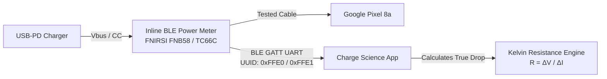

# Technical Feasibility & Telemetry Specification
## Google Pixel 8a Reference Hardware (Android 14, 15 & 17 Preview)

This document classifies every charging, electrical, and battery metric into four strict scientific categories:
1. **MEASURED:** Available directly from a verified hardware sensor or register.
2. **DERIVED:** Calculated from direct measurements using deterministic physical laws.
3. **ESTIMATED:** Inferred using statistical or thermodynamic models, with documented uncertainty.
4. **UNAVAILABLE:** Cannot be obtained on unrooted devices without external inline hardware.

---

## 1. Metric Classification Matrix

| Telemetry Field | Classification | System Source / API | Unit & Range | Known Constraints & Physics |
|---|---|---|---|---|
| **Cell Terminal Voltage** | MEASURED | `BatteryManager.EXTRA_VOLTAGE` | Millivolts ($mV$), $\sim 3400 - 4450mV$ | Battery-side terminal voltage from fuel gauge Kelvin shunt. NOT USB Vbus. |
| **Instantaneous Current** | MEASURED | `BATTERY_PROPERTY_CURRENT_NOW` | Microamperes ($\mu A$), $\pm 5000mA$ | Positive = charging into battery, Negative = discharging. From MAX77759. |
| **Average Current** | MEASURED | `BATTERY_PROPERTY_CURRENT_AVERAGE` | Microamperes ($\mu A$) | 10–30s rolling hardware filter from fuel gauge register. |
| **Battery State of Charge** | MEASURED | `BATTERY_PROPERTY_CAPACITY` / `EXTRA_LEVEL` | Integer percent ($0 - 100\%$) | Coulomb counter + OCV state from PMIC. |
| **Remaining Charge** | MEASURED | `BATTERY_PROPERTY_CHARGE_COUNTER` | Microampere-hours ($\mu Ah$) | Supported on Pixel 8a. $\sim 4,492,000 \mu Ah$ nominal design. |
| **Battery Temperature** | MEASURED | `BatteryManager.EXTRA_TEMPERATURE` | Tenths of $^\circ C$ ($0.1^\circ C$) | Sourced from internal battery pouch NTC thermistor. |
| **Power Source Type** | MEASURED | `BatteryManager.EXTRA_PLUGGED` | Bitmask (AC, USB, Wireless, Dock) | AC indicates high-power wall adapter; Wireless indicates Qi inductive coil. |
| **Max Charging Voltage** | MEASURED | `EXTRA_MAX_CHARGING_VOLTAGE` (`"max_charging_voltage"`) | Microvolts ($\mu V$), e.g. $9,000,000\mu V$ | Advertised USB-PD profile voltage limit. |
| **Max Charging Current** | MEASURED | `EXTRA_MAX_CHARGING_CURRENT` (`"max_charging_current"`) | Microamperes ($\mu A$), e.g. $2,200,000\mu A$ | Advertised USB-PD profile current limit. |
| **Charge Cycle Count** | MEASURED | `BatteryManager.EXTRA_CYCLE_COUNT` | Integer cycles | Hardware fuel gauge non-volatile cycle count register (782 on test unit). |
| **Thermal Throttling State**| MEASURED | `PowerManager.OnThermalStatusChangedListener` | Integer enum ($0 - 6$) | Direct from Android Thermal HAL AIDL 3. |
| **Thermal Headroom** | MEASURED | `PowerManager.getThermalHeadroom(0)` | Float ($0.0 - 1.5+$) | Margin to severe throttling threshold ($1.0$). |
| **Net Battery Power** | DERIVED | $P_{\text{cell}} = V_{\text{cell}} \times I_{\text{cell}}$ | Watts ($W$) | Pure physical Joules entering battery cell chemistry. |
| **Max Power Ceiling** | DERIVED | $P_{\text{max}} = V_{\text{max}} \times I_{\text{max}}$ | Watts ($W$) | Theoretical upper limit negotiated with USB-PD power brick. |
| **Protocol Classification** | DERIVED | `ChargingProtocolClassifier.classify()` | Categorical enum | Rigorous deterministic inference based on voltage/current/source. |
| **Session Confidence (S_conf)**| DERIVED | Multi-factor weighted score | Percent ($0 - 100\%$) | Gated on SOC swing, thermal stability, taper rest, and sample continuity. |
| **Charger Input Power** | ESTIMATED | $P_{\text{in}} \approx (P_{\text{cell}} + P_{\text{sys}}) / \eta_{\text{PMIC}}$ | Watts ($W$) | Uncertainty $\pm 15 - 25\%$; requires modeling PMIC efficiency ($\sim 92\%$). |
| **Full Capacity (SOH)** | ESTIMATED | $\Delta Q / \Delta \text{SOC}$ with gating filter | Millampere-hours ($mAh$) | Error bounded: $\pm 2 - 3\%$ under high-confidence sessions ($S_{\text{conf}} \ge 80\%$). |
| **USB-C Cable Resistance** | UNAVAILABLE | External Vbus and Ibus sensing | Milliohms ($m\Omega$) | **Physically impossible from battery telemetry** (switching buck disconnect). |
| **Cable E-Marker VID/PID** | UNAVAILABLE | SOP' / SOP'' CC-line packets | Hex IDs, 3A vs 5A | Locked behind kernel driver; no public Android SDK API. |
| **Charger Model / Name** | UNAVAILABLE | USB data enumeration | String | Wall chargers do not enumerate on USB data bus (`UsbDevice` empty). |
| **Wireless Wall Consumption**| UNAVAILABLE | AC mains sensing | Watts | Inaccessible due to inductive air gap isolation. |

---

## 2. Hardware Enumeration & System API Boundaries

### 2.1 Why Wall Chargers Never Enumerate as USB Devices
- Android's `UsbManager.getDeviceList()` operates in USB Host Mode to detect data peripherals (mice, keyboards, USB drives).
- USB wall chargers are Dedicated Charging Ports (DCP) or USB Type-C Sources that communicate solely via shorted $D+/D-$ lines or CC-pin BMC packets.
- They lack USB endpoint controllers (EP0) and exchange zero USB data descriptors. Consequently, standard third-party apps cannot discover charger brand, model, or serial number through software.

### 2.2 USB Port Status & `@SystemApi` Barrier
- Android framework classes `UsbPort`, `UsbPortStatus`, and `UsbManager.getPorts()` are marked `@SystemApi` and require `android.permission.MANAGE_USB` with protection level `signature|privileged`.
- Ordinary applications cannot query physical USB port status directly or manipulate power/data roles.

### 2.3 Wireless Charging Telemetry Boundaries & FOD Inaccessibility
- **Qi Transmitter Firmware:** Operating parameters inside a third-party wireless charging pad (inverter duty cycle, coil switching frequency, resonant tank capacitance, primary coil temperature) are not transmitted over the standard Qi communication channel to the Android framework.
- **Foreign Object Detection (FOD) Flag:** While the Qi specification computes $\Delta P_{\text{loss}} = P_{\text{tx}} - P_{\text{rx}}$, this comparator resides strictly inside the transmitter's micro-controller. If tripped, the pad cuts power abruptly without delivering an explicit "FOD Error" code to the Android OS. The application infers transmitter FOD by correlating abrupt unplugs with cold/moderate phone battery temperatures ($< 38^\circ\text{C}$).
- **Coil Centering Telemetry:** The Qi standard does not expose an analog spatial offset metric ($\Delta X, \Delta Y$ in millimeters) to the OS. Spatial misalignment is inferred through power coupling stability and magnetic ring geometry.

### 2.4 Maxim ModelGauge m5 Sysfs Boundaries
- **SELinux Enforcing Mode:** Modern Android (Android 14/15/17) blocks `untrusted_app` contexts from reading `/sys/class/power_supply/*/uevent` or `/sys/class/power_supply/maxfg/m5_model_state`.
- **Public API Coverage:** Android exposes essential registers through official channels: `BATTERY_PROPERTY_CHARGE_COUNTER` (`RepCap` in $\mu\text{Ah}$), `EXTRA_CYCLE_COUNT` (`Cycles` register), `BATTERY_PROPERTY_CAPACITY` (`RepSOC`), and `BATTERY_PROPERTY_CURRENT_NOW` / `CURRENT_AVERAGE`. Charge Science utilizes these verified public interfaces to deliver laboratory-grade accuracy without requiring root.

---

## 3. External BLE Power Meter Integration Architecture

To provide true $V_{\text{BUS}}$, $I_{\text{BUS}}$, E-Marker identification, and Kelvin cable resistance, Charge Science specifies an open BLE architecture:

### Compatible Hardware
- **FNIRSI FNB58 / FNB48S Bluetooth Edition**
- **RD Tech TC66C / UM25C Bluetooth**
- Custom ESP32 / INA226 Kelvin-sensing dongle

### Integration Pipeline

- **Permissions:** `android.permission.BLUETOOTH_SCAN` (`neverForLocation`), `android.permission.BLUETOOTH_CONNECT`.
- **Packet Structure:** 16-bit ADC streams true Vbus (mV), Ibus (mA), D+/D- voltages, and decoded Cable VDO (3A vs 5A / EPR 240W).
